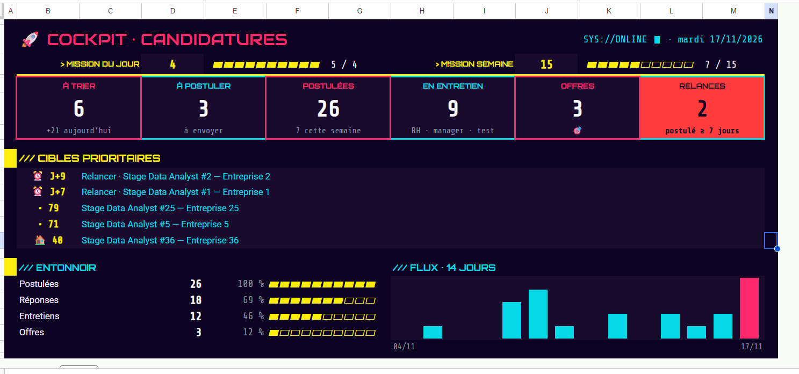
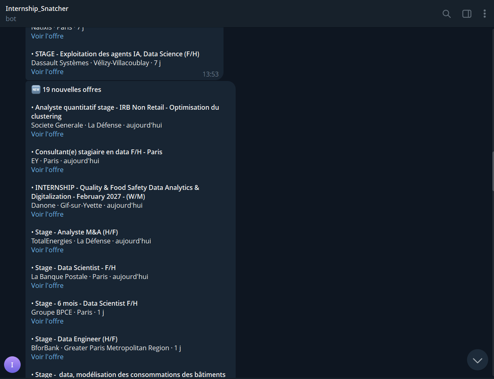

# internship-hunter

[English](README.md) · Français

Un petit outil qui cherche pour moi des stages data en France, les range dans un Google Sheet, note à quel point chacun correspond à mon profil et m'envoie les nouveaux sur Telegram. Il tourne sur mon ordinateur cinq fois par jour.

## Le problème

Je suis étudiant en économétrie à Lille et je cherche un stage data de 6 mois. Les offres de stage sont éparpillées entre LinkedIn et Indeed, la même offre apparaît souvent sur les deux, et la plupart ne correspondent pas. Les suivre à la main dans un tableur prend du temps, et on oublie les relances. Je l'ai construit pour ma propre recherche : il fait la recherche, le tri et les rappels, pour que mon temps aille aux offres qui en valent la peine.

## Ce qu'il fait

- Un Google Sheet comme suivi. Le robot remplit ses propres colonnes (titre, entreprise, ville, région, dates, score, liens) et ne touche jamais aux tiennes (statut, date de candidature, CV utilisé, contact, prochaine action, notes).
- Un onglet cockpit : les objectifs du jour et de la semaine, le nombre d'offres par statut, les relances à faire, les meilleures offres où postuler, et l'entonnoir de la candidature à l'offre.
- Un récapitulatif Telegram après chaque passage qui a trouvé du nouveau, avec d'abord les offres de ta zone prioritaire.
- Un score d'adéquation de 0 à 100 pour chaque offre : les compétences que tu as vraiment, le type de poste, le lieu, la gratification, la fraîcheur, et une pénalité pour les stages de moins de 4 mois.
- La détection des doublons : la même offre sur LinkedIn et Indeed, même avec un titre ou un nom d'entreprise un peu différent, finit sur une seule ligne.
- Un générateur de CV qui n'utilise que des faits que tu as validés. Il les choisit et les ordonne pour chaque offre, il n'écrit jamais de nouvelles phrases.
- Une file d'attente locale quand l'API Sheets est injoignable (un VPN la bloque souvent) : les offres attendent sur le disque et entrent dans le sheet au passage suivant.
- Une protection LinkedIn : au premier « 429 too many requests », le passage arrête d'interroger LinkedIn, et le suivant le saute aussi.

## Comment ça marche

1. Recherche. Toutes les 3 heures de 8 h à 20 h, [JobSpy](https://github.com/speedyapply/JobSpy) interroge Indeed et LinkedIn avec tes mots-clés, sur tout le pays et dans ta zone prioritaire. Le premier passage de la journée remonte 7 jours (environ 40 requêtes), les suivants 24 heures (environ 18).
2. Nettoyage. Seuls les stages avec un intitulé data sont gardés, et les doublons sont fusionnés.
3. Score. Chaque nouvelle offre reçoit son score, calculé sur sa description quand il y en a une, sinon sur son titre (noté « Score fiable = non »).
4. Synchro. Les nouvelles offres arrivent en haut du sheet, celles revues ont leurs dates mises à jour, et le sheet est sauvegardé en CSV avant chaque écriture.
5. Alerte. Les nouvelles offres partent sur Telegram.

## Installation

Ouvre le dépôt dans [Claude Code](https://claude.com/claude-code) et tape `/setup`. Il te guide étape par étape et explique à quoi sert chacune. Compte environ 30 minutes :

1. Python 3.13 et les dépendances.
2. Un compte de service Google Cloud, pour que le script puisse écrire dans ton sheet. C'est gratuit, et tu n'as jamais besoin de l'essai payant.
3. Le Google Sheet, partagé avec ce compte.
4. Un bot Telegram pour le récapitulatif.
5. Ton profil et tes faits de CV, remplis lors d'un entretien. Rien n'est écrit sans ton accord.
6. `config.yaml` : tes mots-clés, ta zone prioritaire, les poids du score.
7. Un premier passage, puis la tâche planifiée Windows.

Tu peux aussi suivre `.claude/commands/setup.md` à la main. CLAUDE.md explique comment fonctionne chaque partie.

## Au quotidien

- Lis le récapitulatif Telegram.
- Dans le sheet, ouvre la vue filtrée Triage (Données > Vues filtrées) et passe chaque nouvelle offre en « À postuler » ou « Pas intéressé ».
- Postule aux meilleures depuis le cockpit. Quand tu mets « Postulé », la date se remplit toute seule.
- La colonne « Prochaine étape » dit quoi faire ensuite pour chaque offre. Sept jours après une candidature sans réponse, elle te dit de relancer et la date de candidature passe en jaune.
- L'onglet Guide contient la routine du jour, avec des cases à cocher.

## Honnêteté

Les scripts de CV n'écrivent jamais de texte. Chaque ligne vient de `cv_facts.fr.yaml`, une banque de faits que tu valides ligne par ligne, et les niveaux de compétence viennent de ta propre évaluation honnête dans `profile.md`. Un paragraphe qu'on ne peut pas rattacher à la banque bloque la génération. Je voulais des CV que je peux défendre en entretien, pas des CV qui sonnent bien.

## Limites

- Windows seulement, et Microsoft Word est nécessaire pour exporter les CV en PDF.
- Pensé pour le marché français : régions françaises, gratification minimale légale, libellés du sheet en français.
- Récupérer automatiquement les offres de LinkedIn et d'Indeed est contraire à leurs conditions d'utilisation. C'est prévu pour un usage personnel à faible volume (5 passages par jour, jamais plus d'un toutes les 3 heures), à tes risques.
- Welcome to the Jungle, HelloWork et JobTeaser ne sont volontairement pas récupérés : leurs conditions l'interdisent, alors je les consulte à la main. Un lecteur d'alertes e-mail existe dans le code mais il est désactivé.
- JobSpy passe par des accès non officiels des sites, donc un changement de leur côté peut casser une recherche jusqu'à la mise à jour de JobSpy.

## Vie privée

Tout ce qui est personnel reste sur ta machine et est ignoré par git : `.env` (l'identifiant du sheet et le jeton Telegram), `credentials/`, `profile.md`, les banques de faits du CV, les CV générés, les offres récupérées, les journaux et les sauvegardes du sheet. Les offres vont dans ton propre Google Sheet et ton propre bot Telegram, nulle part ailleurs.

## Crédits

Construit avec [Claude Code](https://claude.com/claude-code), à partir de [JobSpy](https://github.com/speedyapply/JobSpy) pour la récupération des offres. Licence MIT, voir [LICENSE](LICENSE).
