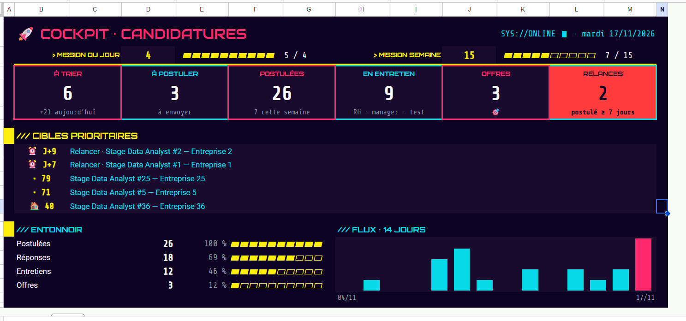
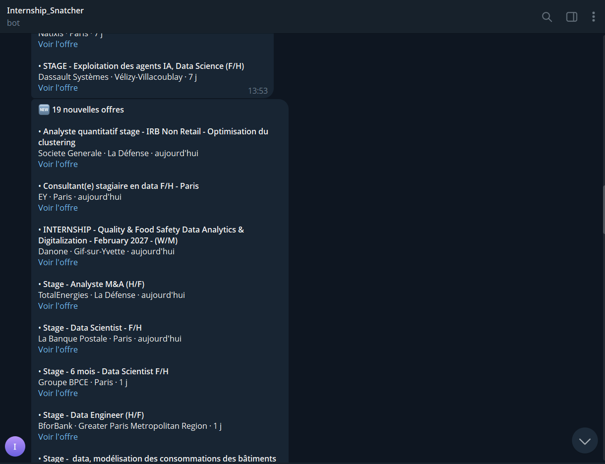

# internship-hunter

English · [Français](README.fr.md)

A small tool that finds data internships in France for me, puts them in a Google Sheet, scores how well each one fits my profile and sends me the new ones on Telegram. It runs on my laptop five times a day.

## The problem

I'm an econometrics student in Lille looking for a 6-month data internship. Internship offers are spread over LinkedIn and Indeed, the same offer often shows up on both, and most of them don't fit. Tracking them by hand in a spreadsheet is slow, and follow-ups get forgotten. I built this for my own search: it does the searching, the sorting and the reminders, so my time goes into the offers that are worth it.

## What it does

- A Google Sheet as the tracker. The robot fills its own columns (title, company, city, region, dates, score, links) and never touches yours (status, application date, CV used, contact, next action, notes).
- A cockpit tab: the day's and the week's goals, counts by status, the follow-ups that are due, the best offers to apply to, and the funnel from application to offer.
- A Telegram digest after each run that found something new, with the offers in your priority area first.
- A fit score from 0 to 100 for each offer: skills you actually have, type of job, place, pay, freshness, and a penalty for internships under 4 months.
- Duplicate detection: the same offer on LinkedIn and Indeed, even with a slightly different title or company name, ends up on one row.
- A CV generator that only uses facts you approved. It picks and orders them for each offer, it never writes new sentences.
- A local queue when the Sheets API can't be reached (a VPN often blocks it): offers wait on disk and go into the sheet on the next run.
- LinkedIn protection: at the first "429 too many requests", the run stops asking LinkedIn and the next run skips it too.

## How it works

1. Scrape. Every 3 hours from 8:00 to 20:00, [JobSpy](https://github.com/speedyapply/JobSpy) searches Indeed and LinkedIn with your terms, nationwide and in your priority area. The first run of the day looks back 7 days (about 40 requests), the others 24 hours (about 18).
2. Clean. Only internships with a data-related title are kept, and duplicates are merged.
3. Score. Each new offer gets its fit score, from its description when there is one, otherwise from its title (marked "Score fiable = non").
4. Sync. New offers go in at the top of the sheet, offers seen again get their dates updated, and the sheet is backed up to a CSV before every write.
5. Notify. The new offers go to Telegram.

## Installation

Open the repo in [Claude Code](https://claude.com/claude-code) and type `/setup`. It walks you through every step and explains why each one is there. Count about 30 minutes:

1. Python 3.13 and the dependencies.
2. A Google Cloud service account, so the script can write to your sheet. It's free, and you never need the paid trial.
3. The Google Sheet, shared with that account.
4. A Telegram bot for the digest.
5. Your profile and CV facts, filled in an interview. Nothing gets written without your OK.
6. `config.yaml`: your search terms, your priority area, the scoring weights.
7. A first run, then the Windows scheduled task.

You can also follow `.claude/commands/setup.md` by hand. CLAUDE.md explains how each part works.

## Daily use

- Read the Telegram digest.
- In the sheet, open the Triage filter view (Data > Filter views) and set each new offer to "À postuler" or "Pas intéressé".
- Apply to the best ones from the cockpit. When you set "Postulé", the date fills itself.
- The "Prochaine étape" column says what to do next for each offer. Seven days after an application with no answer, it says to follow up and the application date turns yellow.
- The Guide tab has the daily routine with checkboxes.

## Honesty

The CV scripts never write prose. Every line comes from `cv_facts.fr.yaml`, a fact bank you approve line by line, and the skill levels come from your own honest rating in `profile.md`. A paragraph that can't be traced back to the bank stops the build. I wanted CVs I can defend in an interview, not CVs that sound good.

## Limitations

- Windows only, and Microsoft Word is needed for the PDF export of the CVs.
- Built for the French market: French regions, the French legal minimum pay, French labels in the sheet.
- Scraping LinkedIn and Indeed is against their terms of use. This is for personal use at a low volume (5 runs a day, never more than one every 3 hours), at your own risk.
- Welcome to the Jungle, HelloWork and JobTeaser are deliberately not scraped: their terms forbid it, so I check them by hand. An email-alert reader exists in the code but is turned off.
- JobSpy uses the sites' unofficial endpoints, so a site change can break a search until JobSpy is updated.

## Privacy

Everything personal stays on your machine and is git-ignored: `.env` (the sheet ID and the Telegram token), `credentials/`, `profile.md`, the CV fact banks, the generated CVs, the scraped offers, the logs and the sheet backups. The offers go to your own Google Sheet and your own Telegram bot, nowhere else.

## Credits

Built with [Claude Code](https://claude.com/claude-code), on top of [JobSpy](https://github.com/speedyapply/JobSpy) for the scraping. MIT licence, see [LICENSE](LICENSE).
